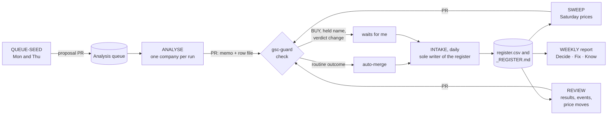

# Guided tour

*How this repository works, for a reader with ten minutes. Jakub Horyna, 8 Nov 2026.*

## What it is

This is a research system for one investor. It applies one method, Kenneth Jeffrey Marshall's Value Investing Model from *Good Stocks Cheap*, to as many listed companies as possible. The results are kept as plain Markdown files under git.

The work is split like this:

- **The agents** (Anthropic's Claude Code) do the routine work: they pull filings, build ten-year records and write the memos. They run on schedules, and every run is a pull request.
- **I** write the rules and decide every change to them. I approve anything that touches money, and I own every decision.

Marshall was my professor at the Stockholm School of Economics. This repository is not affiliated with him and he has not endorsed it.

The design goal comes from the book: **same data, same verdict.** Two sessions given the same filings must reach the same answer. Every judgement call is written down where a reader can find it and challenge it.

## The method on one screen

There are three questions, asked in strict order (MODEL §2):

1. **Do I understand it?** The memo writes one plain sentence covering what the company sells, who pays for it, its industry, its legal and operating form, where it operates, and its stage. A company fails here only if its filings don't show what it sells, and to whom, for more than half of its revenue.
2. **Is it good?** There are three tests, and failing any one of them is enough:
   - **Past.** Ten years of returns on capital, read on the worst of four averaging methods. STRONG needs ROCE ≥ 15% and an FCF return ≥ 8%; ADEQUATE allows 10% if growth is strong. Per-share growth in operating income and FCF. Liabilities no higher than 200% of equity.
   - **Future.** Concentration of customers and suppliers. Four competitive forces, each rated STRONG or WEAK, with no middle grade. One identified source of moat. The direction of the market. No forecasts.
   - **Shareholder-friendliness.** Pay measured against FCF and against absolute limits. Related-party dealings. Capital allocation: buybacks and acquisitions are judged against what the business was worth when the board acted.
3. **Is it cheap?** Market cap at most 8× free cash flow, with only maintenance capex deducted. Enterprise value at most 7× operating income, using the lowest reported operating line and never an adjusted one. Both tests must pass with and without counting cash.

| Result | Verdict |
|---|---|
| Can't be understood from its filings | DO NOT ANALYSE FURTHER |
| Any quality test fails | AVOID |
| Good, but not cheap | WATCH, with a trigger price |
| Good and cheap | BUY (framework) |

Positions I hold fall into one of three zones:

- **ADD:** the price is at or under the trigger, and every gate is confirmed.
- **HOLD:** everything between ADD and SELL-FLAG.
- **SELL-FLAG:** the price is past 25× operating income, or a quality gate fails, or a buyout is announced.

The framework raises the flag, and I make the decision.

Most verdicts come out WATCH or AVOID. A long WATCH list with trigger prices is the point: it is the shopping list for the next market fall.

## Map

| Path | What it is | Open it for |
|---|---|---|
| [`_REGISTER.md`](../_REGISTER.md) | One line per company: verdict, grades with reasons, price, trigger price, multiples | The whole book at a glance |
| [`memos/<TICKER>/`](../memos/) | The current memo, exactly one per company. A body of up to 800 words, then the evidence: sources, ten-year tables, calculations, shareholder-friendliness worksheets, valuation and a change log | One company in depth |
| [`archive/`](../archive/) | Every earlier memo and register version, unchanged | How a view moved over time |
| [`model/MODEL.md`](../model/MODEL.md) | The rules: gates, parameters (§3), memo format, register, playbooks, change log | What exactly a verdict means |
| [`model/BOOK_EXTRACT.md`](../model/BOOK_EXTRACT.md) | The book's doctrine and every place the project departs from it. Where I overruled Marshall, his view is recorded | Where the rules come from |
| [`routines/`](../routines/) | Playbooks for the scheduled agents, and the Python tools that write the register | How the automation works |
| [`queue/`](../queue/) | Work in progress: the analysis queue, the to-do list, framework ideas, run notes | What comes next |
| `.claude/`, `.github/` | The guard hook that sandboxes the agents, the GitHub checks and the auto-merge | The controls |
| [`docs/`](./) | These write-ups | |

## How a company moves through the system

1. **Seed.** Twice a week an agent proposes new companies for the queue. I approve them by merging the proposal.
2. **Analyse.** Each evening an agent takes the next company and opens a pull request whose title claims it, so no other run picks it up. It writes the memo from primary filings. Each run covers one company in about 90 minutes, with a budget of about five exploratory web searches. Retrieving filings doesn't count against that budget.
3. **Check and merge.** A GitHub check tests every routine PR against its write contract, which lists the files that job may touch. Routine outcomes merge automatically. Anything involving a BUY, a company I hold or a changed verdict waits for me.
4. **Intake.** A single daily job is the only writer of the register. It regenerates each row from the memo with a Python tool (`routines/tools/gsc_register.py`) and recomputes the multiples. It also archives the outgoing version and checks `main` for anything that bypassed a pull request.
5. **Sweep and review.** On Saturdays a run prices the watchlist and the portfolio. New results, company events and large price moves put a company in line for a review. A review writes a complete new memo and moves the old one to the archive unchanged.
6. **Weekly report.** On Sunday one private page lists what needs my decision, what is broken and what changed. My phone gets only two kinds of notification: that report, and a BUY.

## Why the output can be trusted, as far as it can

- **Primary sources come first.** Filings beat data services. A data service's ten-year series is accepted only if it ties out exactly to the filings on four anchor figures. Otherwise the record is rebuilt from the filings (MODEL §4).
- **No invented numbers.** "n/a — not disclosed" is better than a guess. Every derived figure is labelled.
- **Memos can be checked by machine.** Each memo's header carries the inputs behind its multiples. A linter recomputes them and fails the memo if they don't reproduce to within ±0.1.
- **The agents are sandboxed.** A hook refuses any command outside the job's contract, so an agent can't push to `main`, edit the rules or work outside its own branch. The hook tests itself at the start of every run.
- **Nothing reaches `main` except by pull request.** Memos are never edited in place and `archive/` is append-only, so the history can't be quietly rewritten.
- **One writer for the register.** Only the daily intake writes it, so parallel runs can't overwrite each other's work.
- **Holdings get no kinder reading.** Every memo on a company I hold records a check for consistency bias and loss aversion, and states whether a stranger would read the evidence the same way.

## How the rules change

Rules never change during an analysis. The process is:

1. A proposed rule goes into [`queue/IDEAS.md`](../queue/IDEAS.md).
2. In a separate session it is tested against the book and drafted as a full diff of `MODEL.md`.
3. The draft is scanned for every verdict it could move.
4. It lands only when I type the words "commit model". The old version is frozen in [`model/archive/`](../model/archive/).
5. The new rule applies from each company's next run. It never applies backwards.

Where I chose something softer than the book, Marshall's position is recorded as dissent in `BOOK_EXTRACT.md` §13. Since July 2026 the framework has gone from v3.2.0 to v4.8.0, 29 versions in all.

## By the numbers (8 Nov 2026)

- **498 companies** on the register: 69 WATCH, 426 AVOID, 2 DNAF, 1 retired, 0 BUY.
- **4 held positions:** CROX, NOVO-B.CO, TROW and HFG.DE. The framework currently flags all four for sale, and I hold them by logged decisions. The [CROX review](2026-11-08_CROX_holding-period-review_v1.md) and the [HelloFresh post-mortem](2026-11-08_HFG_post-mortem_v1.md) explain why.
- **1,865 commits** since 5 July 2026 and 345 register versions.
- **Over 300 routine research runs merged:** 207 analyses and 112 reviews.
- **About 25,000 lines of Python**, tests included, for the register tool, the guard and the workflows.

## Known limits

- **It is strict by design.** Zero BUYs out of 498 means the method is working, but it does miss winners. It would have kept me out of CROX in 2023.
- **Agents make mistakes, and some get through.** While writing these notes I found an arithmetic slip in the current CROX memo: Appendix E says 13.6× where its own inputs give 11.9×. It changes no reading, and the next review will correct it. The controls catch the errors that matter most to a verdict, not every error.
- **Long jobs can run out of time.** Ten reviews hit their time budget between 8 and 29 October. Since v4.8.0 they resume from a cited record instead of starting over.
- **It reads public filings only.** No management calls, no channel checks, no paid data.

## Where to go next

Start with the [CROX review](2026-11-08_CROX_holding-period-review_v1.md) and the [HelloFresh post-mortem](2026-11-08_HFG_post-mortem_v1.md). Then open one memo and read sections 1–8 of the body, which takes about three minutes. If the method interests you, read `MODEL.md` §2.

*Not investment advice.*
